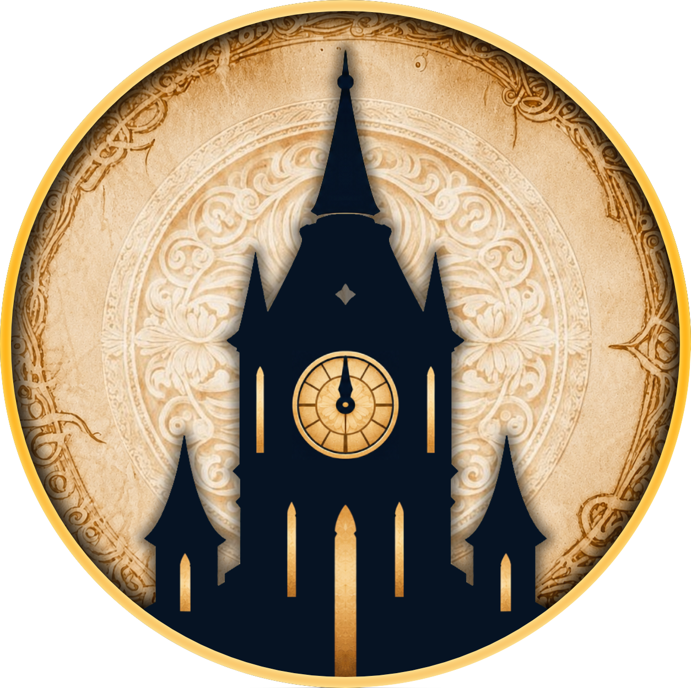

# Blood on the Clocktower Grimoire & Townsquare
<p align="center">
    <a href="https://townsquare.tazaraz.dev">
        
    </a>
</p>
<h2 align="center">
  <a href="https://townsquare.tazaraz.dev">Try it out!</a>
</h2>
<br>

This is an unofficial application for hosting [Blood on the Clocktower](https://bloodontheclocktower.com) games. It is designed to help the storyteller and players to run a game by running votes, handing out sheets, roles, and more.

This app is inspired by the original [Townsquare](https://github.com/bra1n/townsquare) by Steffen, but this version implements mobile support, a new design, and a new user interface. Despite this, it does follow the same principles as the original Townsquare, and transitioning from one to the other should be easy.

## Features
* Storyteller and player grimoire
* Live sessions, providing communication, voting, role and bluff syncing, and more to players.
  - Simple storyteller to player communication, including tokens/roles
  - Allows showing the storyteller grimoire to players for specific roles
* Automatic syncing of both the reference sheet and night order
* The three base editions, as well as some preloaded custom scripts
* Includes support for both Fabled and Loric characters
* Support for custom scripts from the [official script tool](https://bloodontheclocktower.com/script)

## Custom scripts
This tool supports [custom script](https://bloodontheclocktower.com/script) parsing as [defined](https://github.com/ThePandemoniumInstitute/botc-release/blob/main/script-schema.json) by The Pandemonium Institute, although not all `meta` entries are used. The `Script Character` item type is not supported in the live version.

You can add custom characters by editing [`data/roles.json`](./app/data/roles.json), following the structure of the existing roles. Because role data is bundled during the Nuxt build, you'll need to rebuild the application for changes to take effect.

**Note**: The scheduled data synchronization job overwrites this file with data from the official repository. Disable the scheduled cron job [here](./Dockerfile) if you want to preserve your custom changes.

## Self-hosting

Townsquare can be run locally or deployed using Docker Compose.

**Development**

```bash
docker compose up
```

**Production**

```bash
docker compose -f docker-compose.prod.yml up -d --build
```

## Contributions
Always welcome! Leave an issue via the issues tab, and I will try to look at it as soon as possible. If you want to contribute code, please fork the repository and submit a pull request.

> #### If you're contributing code, before creating a pull request, do the following:
> - Make sure all tests pass, and create new tests for your code if applicable.
> - Leave comments and documentation for your code.
>   - If unsure how much, take my level of documentation as a reference
> - This project was made without AI generated code, but with the help of AI. Disclose any use of AI.

## Acknowledgements & Copyrights
* [Blood on the Clocktower](https://bloodontheclocktower.com) is a trademark of Steven Medway and The Pandemonium Institute.
* Icons and game data are synced from the [official Blood on the Clocktower repository](https://github.com/ThePandemoniumInstitute/botc-release)
* Background obtained from [Vecteezy](https://www.vecteezy.com/vector-art/77164940-minimalist-village-line-art-illustration)
* Original inspiration comes from [Townsquare](https://github.com/bra1n/townsquare) by Steffen.
* This project is not affiliated with or endorsed by The Pandemonium Institute, and is not an official product of Blood on the Clocktower. It is a fan-made project created for the enjoyment of the community.
